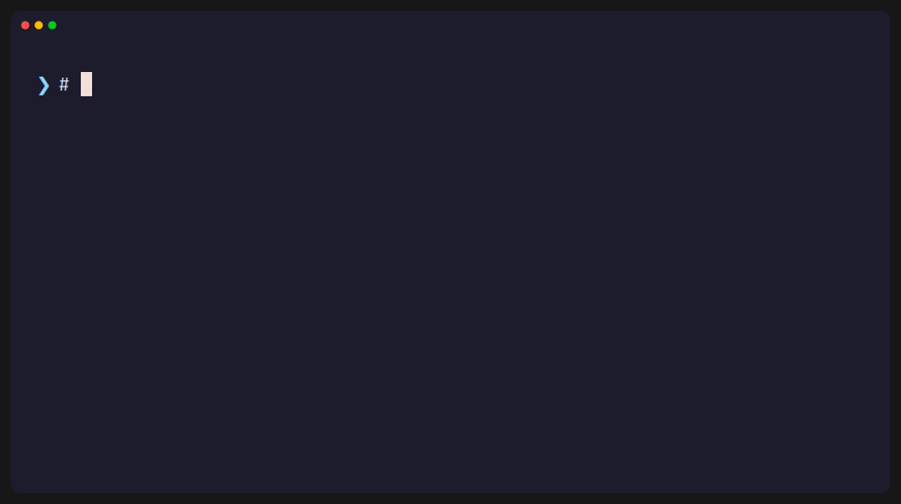
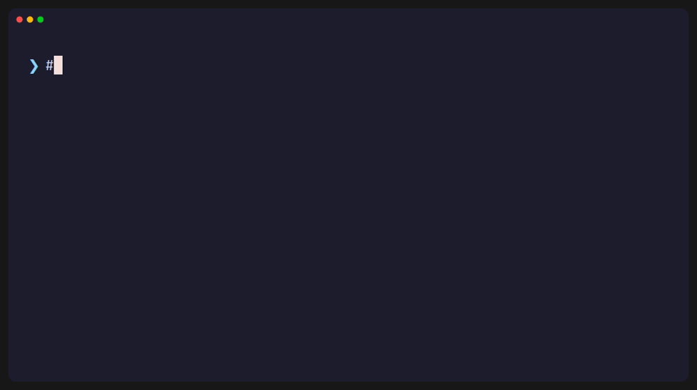

<div align="center">

```
887    d8P  8888888 8888888b.        d8888
887   d8P     888   888  "Y88b      d88888
887  d8P      888   888    888     d88P888
887d88K       888   888    888    d88P 888
8888887b      888   888    888   d88P  888
887  Y88b     888   888    888  d88P   888
887   Y88b    888   888  .d88P d8888888888
887    Y88b 8888888 8888888P" d88P     888
```

### Simplify your home server operations

Manage Docker, backups, scheduled tasks and system operations from a single tool.


</div>

---

## .✦ ݁˖ Why KIDA

Automate routine work, keep your backups ready and control your server from one place. Self-hosted, with a terminal client and an API for your own tools.

## .✦ ݁˖ Capabilities

|     | Capability                    | What it does                                                            |
| --- | ----------------------------- | ----------------------------------------------------------------------- |
| 🐳   | **Docker Management**         | List, start, stop, restart, and remove containers.                      |
| 💾   | **Backup Management**         | Configure, manage, and execute backup jobs.                             |
| 🕒   | **Task Scheduling**           | Automate recurring operations with scheduled jobs.                      |
| 🖥️  | **System Control**            | Monitor system health, inspect hardware, reboot, and shut down.         |
| 🔌   | **CLI & HTTP**                | Work from the terminal or integrate your own tools.                     |
| 🏠   | **Self-Hosted & Lightweight** | A native Rust agent running on your infrastructure, under your control. |

## .✦ ݁˖ KIDA in action

<div align="center">

Define your sources and destinations, register the job, and run it on demand.


\>< >< >< ><

Test your backups in a separate environment with Backup Health.


\>< >< >< ><

Automate recurring backups and server operations.


\>< >< >< ><

Inspect your containers, restart a service, and queue a backup from the same CLI.


</div>

## .✦ ݁˖ Documentation

[Castellano](README.es.md) · [All documentation](resources/docs/index.md)

Start with [installation](resources/docs/en/001-installation.md) or browse the
[user guides](resources/docs/en/000-index.md).

## .✦ ݁˖ License

This checkout does not currently include a license file or licensing terms in its package manifests.
